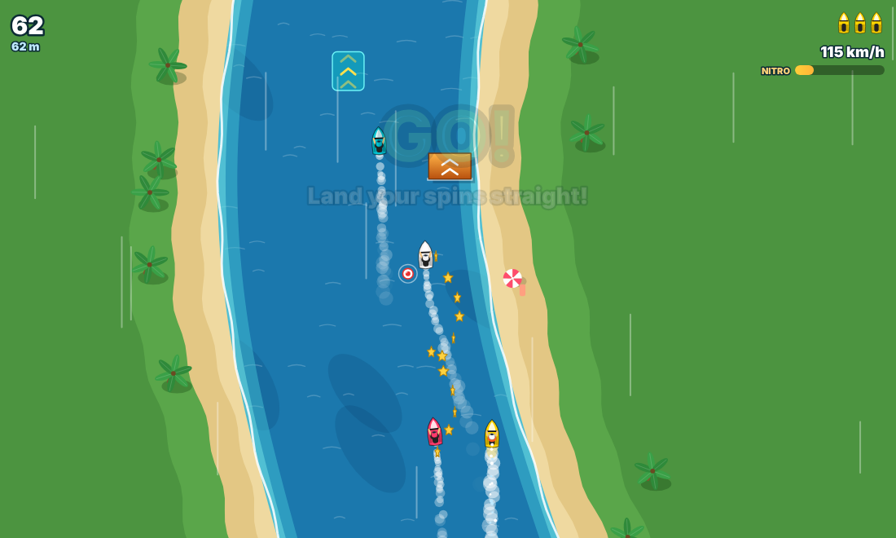

# Surge Rider

A small jetski arcade game for the browser. Hit ramps, land clean spins, boost into rivals and survive the river for as long as you can.

**[Play it here](https://howtoaicontent.github.io/surge-rider/)**



It is plain HTML, CSS and JavaScript drawn on a single canvas, with no dependencies and no build step. It works with keyboard on desktop and with on-screen buttons on touch devices.

## Built with generative AI

This game was written with Claude Opus as an example of what generative AI can build. It is shared freely for anyone to play, read, learn from and reuse. See [License](#license).

## Controls

| Input               | Desktop                | Touch         |
| ------------------- | ---------------------- | ------------- |
| Steer / spin in air | `←` `→` or `A` `D`     | ◀ ▶ buttons   |
| Throttle / brake    | `↑` / `↓` or `W` / `S` | BRAKE button  |
| Nitro               | `Space` or `Shift`     | NITRO button  |
| Pause / mute        | `P` or `Esc` / `M`     | Tap to resume |

## How to play

- Ramps launch you into the air. Steer to spin, then release the keys so you are straight when you land.
- Cyan pads give a speed boost and red cans refill nitro.
- Boost into rivals, or land on them, for takedowns.
- Close calls and tricks raise your score multiplier.
- You have three lives, and an extra life every 20,000 points.

Your best score is saved in the browser's `localStorage`.

## Run it locally

Open `index.html` in a browser, or serve the folder:

```bash
python3 -m http.server 8000
```

Then visit `http://localhost:8000`.

## Files

| File         | Purpose                              |
| ------------ | ------------------------------------ |
| `index.html` | Page shell, metadata, touch controls |
| `style.css`  | Layout and touch button styles       |
| `game.js`    | Game logic, rendering and audio      |

## License

[BSD Zero Clause License (0BSD)](LICENSE). Use it for anything, with no attribution required. Built with Opus 5.5 by Björn Sennbrink.
